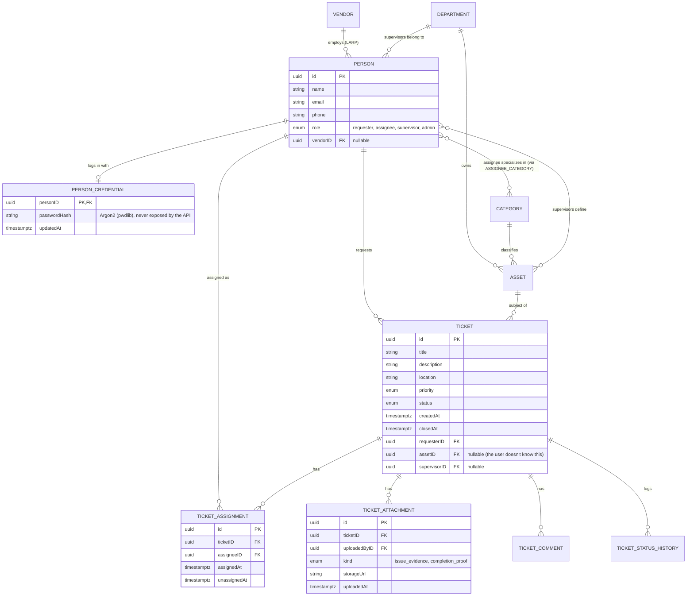

# SPEC

## Features
- Ticket Creation and Management
- Creation of Supervisor and Vendor accounts by Admin
- Chat Functionality amongst Supervisor, User and Assignee
- [Optional] Automatic assigning of Assignees to tickets

## Role-wise functionality
### User
- *Create* their own accounts
- *Create* Tickets
- *Attach* media (evidence / proof) to tickets
- *View*, *Edit* and *Close* open tickets created by them
- Chat with **Supervisor** and **Assignee**
### Supervisor
- *View* and *Close* tickets belonging to their Department
- Assign appropriate **Assignees** (i.e. assignees suitable to work in that department) to tickets (multiple assignees can be assigned to a single ticket)
- Chat with **Users** and **Assignees**
### Assignee
- *View* tickets assigned to them
- *Attach* completion proof media to tickets
- Chat with **User** and **Supervisor**
### Admin
- *Create* and *Delete* accounts of **Supervisors** and **Assignees**
- *View*, *Close* and *Delete* any and all tickets (access to entire ticket db)

## Database Schema

